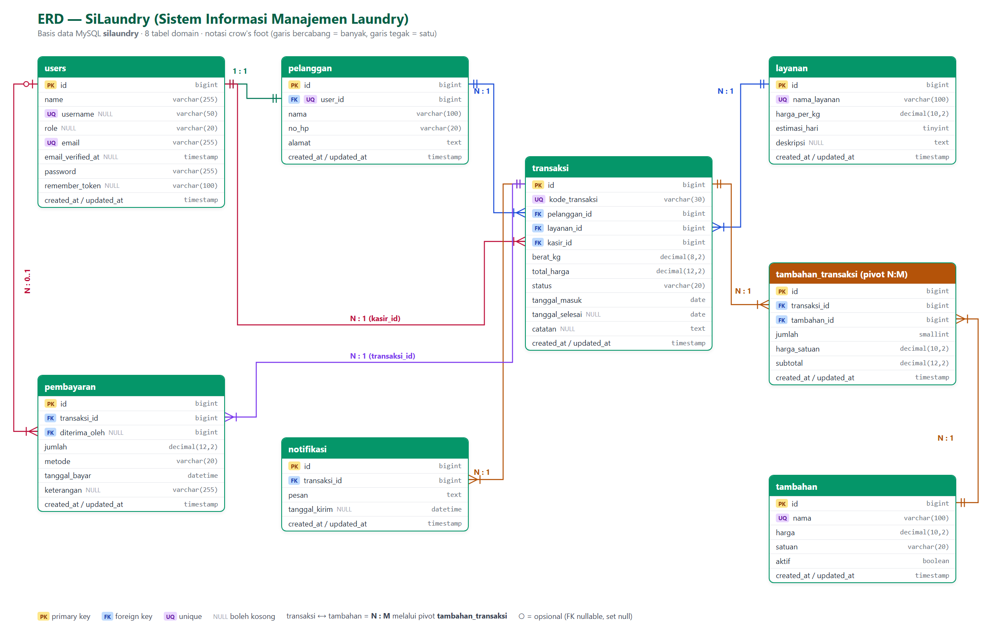
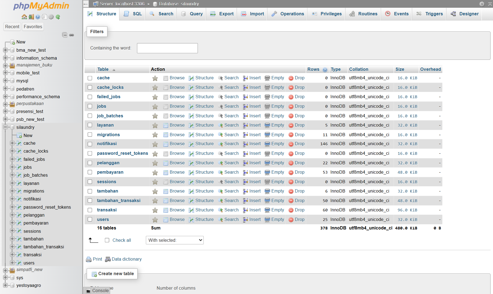
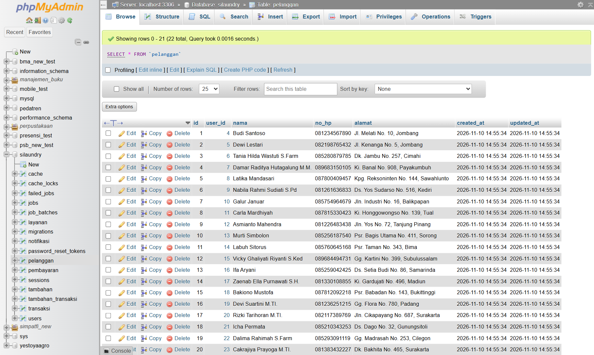
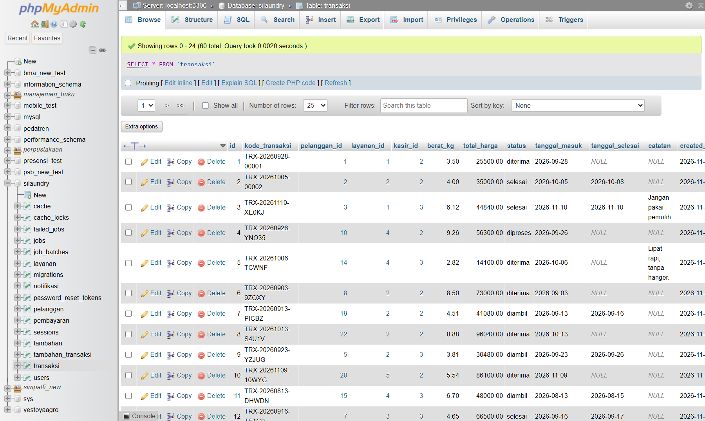
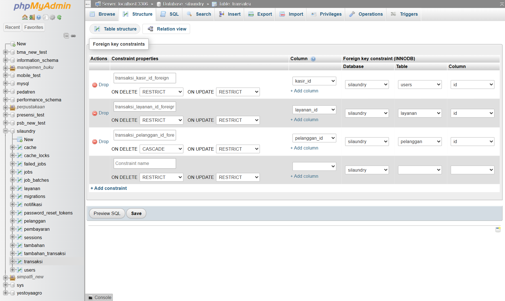

# LEMBAR KERJA PRAKTIKUM (LKP) — Pertemuan 4

**Basis Data, Migrasi, Eloquent & Seeder**
Tugas Mandiri: Implementasi Database Sesuai Proyek Kelompok

Pemrograman Web Lanjut · Teknik Informatika — Universitas Hasyim Asy'ari Tebuireng Jombang · Semester V
Dosen Pengampu: Edwin Hari Agus Prastyo, S.Kom., M.Kom.

---

## I. IDENTITAS MAHASISWA & PROYEK

| Komponen | Isian Mahasiswa |
|---|---|
| Nama Lengkap | Ahmad Mofidur Robbiyal Aqla |
| NIM | 2495114006 |
| Kelas / Semester | ______ / V (Lima) |
| Nama Kelompok | Kelompok ______ |
| Judul Proyek Web | SiLaundry — Sistem Informasi Manajemen Laundry |
| Kasus Proyek Kelompok | Kasus ____ — Sistem Informasi Manajemen Laundry (transaksi cucian kiloan, layanan tambahan, pembayaran, notifikasi status) |
| URL Repositori Git | https://github.com/RequimeOfficial/Pemograman-Web-Lanjut-sesi-4 |
| Branch Pengerjaan | `main` |

---

## II. CAPAIAN & TUJUAN PRAKTIKUM

Mengonfigurasi koneksi MySQL (Laragon) di `.env`, merancang ERD, menyusun migrasi berurutan dengan constraint,
membuat model Eloquent berelasi, mengisi data dummy dengan Factory + Seeder, lalu memverifikasi hasilnya di DBMS
(CPMK-1 / S2 dan CPMK-2 / S4).

## IV. ALAT, BAHAN & LINGKUNGAN KERJA

| Kebutuhan | Software / Komponen | Status Kesiapan |
|---|---|---|
| Web Server & Database | Laragon + MySQL 8.0.30 | [X] Aktif |
| Runtime & Package Manager | PHP 8.4.20 & Composer 2.x | [X] Terpasang |
| IDE / Code Editor | Visual Studio Code | [X] Siap |
| Database Client | phpMyAdmin 5.2.3 (bawaan Laragon) | [X] Siap |
| Diagramming Tool | dbdiagram.io (DBML) | [X] Siap |
| Proyek Laravel | SiLaundry (Laravel 13) hasil LKP sebelumnya | [X] Siap berjalan |

---

## V. LEMBAR KERJA MAHASISWA MANDIRI

### TAHAP 1: PERANCANGAN ENTITAS & RELASI (ERD)

#### 1.1 Identifikasi Entitas / Model Proyek

| No | Nama Entitas (Model) | Nama Tabel (Database) | Fungsi & Peran dalam Sistem |
|---|---|---|---|
| 1 | User | users | Autentikasi dan identitas pengguna sistem (role admin / kasir / pelanggan) |
| 2 | Pelanggan | pelanggan | Data diri pelanggan laundry (nama, no HP, alamat); terhubung 1:1 dengan akun `users` |
| 3 | Layanan | layanan | Master layanan utama (Cuci Reguler, Cuci Setrika, dst.) beserta tarif per kg dan estimasi hari |
| 4 | Tambahan | tambahan | Master layanan tambahan / add-on (parfum, hanger, hapus noda, plastik packing) |
| 5 | Transaksi | transaksi | Pesanan laundry: pelanggan, layanan, kasir pencatat, berat, total harga, status, tanggal |
| 6 | — (pivot) | tambahan_transaksi | Tabel penghubung N:M transaksi ⟷ tambahan, menyimpan jumlah, harga satuan, subtotal |
| 7 | Pembayaran | pembayaran | Riwayat pembayaran transaksi (uang muka / pelunasan), metode, kasir penerima |
| 8 | Notifikasi | notifikasi | Pesan pemberitahuan perubahan status transaksi kepada pelanggan |

> Catatan penamaan: tabel memakai kata benda Bahasa Indonesia bentuk tunggal (`pelanggan`, `transaksi`) karena
> Bahasa Indonesia tidak mengenal akhiran jamak "-s"; nama tabel ditetapkan eksplisit lewat properti
> `protected $table` di setiap model. Tabel pivot mengikuti konvensi Laravel: dua nama tabel tunggal diurutkan
> abjad (`tambahan_transaksi`).

#### 1.2 Matriks Pemetaan Relasi Antar Entitas

| No | Entitas Asal | Bentuk Relasi | Entitas Target | Kolom Kunci Tamu (Foreign Key) |
|---|---|---|---|---|
| 1 | Pelanggan | 1 : N | Transaksi | `transaksi.pelanggan_id` → `pelanggan.id` (cascade) |
| 2 | User | 1 : 1 | Pelanggan | `pelanggan.user_id` → `users.id` (UNIQUE, cascade) |
| 3 | Transaksi | N : M | Tambahan | Tabel Pivot: **`tambahan_transaksi`** (`transaksi_id`, `tambahan_id`) |
| 4 | Layanan | 1 : N | Transaksi | `transaksi.layanan_id` → `layanan.id` (restrict) |
| 5 | User (kasir) | 1 : N | Transaksi | `transaksi.kasir_id` → `users.id` (restrict) |
| 6 | Transaksi | 1 : N | Pembayaran | `pembayaran.transaksi_id` → `transaksi.id` (cascade) |
| 7 | Transaksi | 1 : N | Notifikasi | `notifikasi.transaksi_id` → `transaksi.id` (cascade) |
| 8 | User (kasir) | 1 : N (opsional) | Pembayaran | `pembayaran.diterima_oleh` → `users.id` (nullable, set null) |

#### 1.3 Diagram Hubungan Entitas (ERD)



```
Path berkas gambar ERD : screenshots/erd_proyek.png
Tools yang digunakan   : dbdiagram.io (sumber DBML: docs/erd/silaundry.dbml), diekspor ke PNG
```

---

### TAHAP 2: KONFIGURASI DATABASE & ENVIRONMENT

#### 2.1 Pembuatan Database pada DBMS

- Nama Database : **silaundry**
- Collation     : **utf8mb4_unicode_ci**

#### 2.2 Konfigurasi Berkas .env

```env
DB_CONNECTION=mysql
DB_HOST=127.0.0.1
DB_PORT=3306
DB_DATABASE=silaundry
DB_USERNAME=root
DB_PASSWORD=
```

Berkas `.env` tidak di-commit (tercantum di `.gitignore`); repositori hanya menyertakan `.env.example` dengan
isi koneksi yang sama dan `APP_FAKER_LOCALE=id_ID` agar data dummy berbahasa Indonesia.

#### 2.3 Uji Koneksi Database

Perintah: `php artisan migrate:status`

```
 Migration name ........................................................ Batch / Status
 0001_01_01_000000_create_users_table ......................................... [1] Ran
 0001_01_01_000001_create_cache_table ......................................... [1] Ran
 0001_01_01_000002_create_jobs_table .......................................... [1] Ran
 2026_09_28_171321_create_pelanggan_table ..................................... [1] Ran
 2026_09_28_171329_create_layanan_table ....................................... [1] Ran
 2026_09_28_171341_create_transaksi_table ..................................... [1] Ran
 2026_09_28_171347_create_notifikasi_table .................................... [1] Ran
 2026_09_28_172110_add_username_and_role_to_users_table ....................... [1] Ran
 2026_11_10_145141_create_tambahan_table ...................................... [1] Ran
 2026_11_10_145143_create_tambahan_transaksi_table ............................ [1] Ran
 2026_11_10_145145_create_pembayaran_table .................................... [1] Ran
```

Perintah berhasil membaca tabel `migrations` di MySQL sehingga koneksi `.env` terbukti benar. Sebelum
`migrate:fresh`, tiga migrasi baru (tambahan, tambahan_transaksi, pembayaran) sempat berstatus *Pending*.

Status koneksi: [X] Terhubung Berhasil  /  [ ] Terjadi Kendala: —

---

### TAHAP 3: IMPLEMENTASI SKEMA MIGRASI

#### 3.1 Berkas Migrasi di Repositori

Urut dari tabel master ke tabel anak/transaksi:

| No | Berkas Migrasi (database/migrations/) | Tabel yang Dibuat | Commit |
|---|---|---|---|
| 1 | `0001_01_01_000000_create_users_table.php` | users, password_reset_tokens, sessions | [X] |
| 2 | `2026_09_28_171321_create_pelanggan_table.php` | pelanggan | [X] |
| 3 | `2026_09_28_171329_create_layanan_table.php` | layanan | [X] |
| 4 | `2026_09_28_171341_create_transaksi_table.php` | transaksi | [X] |
| 5 | `2026_09_28_171347_create_notifikasi_table.php` | notifikasi | [X] |
| 6 | `2026_09_28_172110_add_username_and_role_to_users_table.php` | (ubah tabel users: kolom username & role) | [X] |
| 7 | `2026_11_10_145141_create_tambahan_table.php` | tambahan | [X] |
| 8 | `2026_11_10_145143_create_tambahan_transaksi_table.php` | tambahan_transaksi (pivot) | [X] |
| 9 | `2026_11_10_145145_create_pembayaran_table.php` | pembayaran | [X] |

(Migrasi bawaan `create_cache_table` dan `create_jobs_table` juga ikut dijalankan.)

#### 3.2 Skema Tabel Master Inti (Tabel 1)

- Nama Tabel: **layanan**
- Berkas Migrasi: `database/migrations/2026_09_28_171329_create_layanan_table.php`
- Status Commit: [X] Ter-commit

| Nama Kolom | Tipe Data | Nullable | Keterangan / Aturan |
|---|---|---|---|
| id | BIGINT UNSIGNED | Tidak | Primary key, auto increment |
| nama_layanan | VARCHAR(100) | Tidak | UNIQUE — nama layanan tidak boleh ganda |
| harga_per_kg | DECIMAL(10,2) | Tidak | Tarif per kilogram (decimal agar tidak ada galat pembulatan uang) |
| estimasi_hari | TINYINT UNSIGNED | Tidak | Default 2; lama pengerjaan, dipakai menghitung tanggal selesai |
| deskripsi | TEXT | Ya | Keterangan layanan |
| created_at, updated_at | TIMESTAMP | Ya | Dikelola otomatis oleh Eloquent |

#### 3.3 Skema Tabel Transaksi / Detail dengan Foreign Key (Tabel 2)

- Nama Tabel: **transaksi**
- Berkas Migrasi: `database/migrations/2026_09_28_171341_create_transaksi_table.php`
- Merujuk ke Tabel: **pelanggan**, **layanan**, dan **users** (kasir)
- Status Commit: [X] Ter-commit

| Nama Kolom | Tipe Data | Foreign Key / Constraint | Keterangan |
|---|---|---|---|
| id | BIGINT UNSIGNED | PK, auto increment | — |
| kode_transaksi | VARCHAR(30) | UNIQUE | Dibuat otomatis oleh model, mis. `TRX-20261110-AB12C` |
| pelanggan_id | BIGINT UNSIGNED | FK → pelanggan.id, `cascadeOnDelete()` | Pelanggan dihapus → riwayat transaksinya ikut terhapus |
| layanan_id | BIGINT UNSIGNED | FK → layanan.id, `restrictOnDelete()` | Layanan yang masih dipakai tidak bisa dihapus |
| kasir_id | BIGINT UNSIGNED | FK → users.id, `restrictOnDelete()` | Kasir pencatat; akun tidak bisa dihapus selama punya transaksi |
| berat_kg | DECIMAL(8,2) | — | Berat cucian |
| total_harga | DECIMAL(12,2) | — | Berat × tarif + subtotal layanan tambahan |
| status | VARCHAR(20) | INDEX, default `diterima` | diterima / diproses / selesai / diambil |
| tanggal_masuk | DATE | — | Tanggal cucian diterima |
| tanggal_selesai | DATE | NULLABLE | Terisi hanya saat status selesai / diambil |
| catatan | TEXT | NULLABLE | Permintaan khusus pelanggan |
| created_at, updated_at | TIMESTAMP | — | Otomatis |

#### 3.4 Skema Tabel Tambahan / Pivot (Tabel 3 dan Seterusnya)

**a. Tabel `tambahan_transaksi` (pivot N:M)**
- Berkas Migrasi: `database/migrations/2026_11_10_145143_create_tambahan_transaksi_table.php`
- Status Commit: [X] Ter-commit

| Nama Kolom | Tipe Data | Constraint / Relasi | Keterangan |
|---|---|---|---|
| id | BIGINT UNSIGNED | PK | — |
| transaksi_id | BIGINT UNSIGNED | FK → transaksi.id, cascade | Ikut terhapus bila transaksi dihapus |
| tambahan_id | BIGINT UNSIGNED | FK → tambahan.id, restrict | Master tambahan yang sudah dipakai tidak bisa dihapus |
| jumlah | SMALLINT UNSIGNED | default 1 | Banyaknya item tambahan |
| harga_satuan | DECIMAL(10,2) | — | Salinan harga saat transaksi (riwayat tidak berubah bila harga master naik) |
| subtotal | DECIMAL(12,2) | — | jumlah × harga_satuan |
| (transaksi_id, tambahan_id) | — | UNIQUE komposit | Satu jenis tambahan hanya sekali per transaksi |

**b. Tabel `tambahan`**
- Berkas Migrasi: `database/migrations/2026_11_10_145141_create_tambahan_table.php`
- Status Commit: [X] Ter-commit

| Nama Kolom | Tipe Data | Constraint / Relasi | Keterangan |
|---|---|---|---|
| id | BIGINT UNSIGNED | PK | — |
| nama | VARCHAR(100) | UNIQUE | Nama add-on |
| harga | DECIMAL(10,2) | — | Harga per satuan |
| satuan | VARCHAR(20) | default `pcs` | pcs / transaksi |
| aktif | BOOLEAN | default true | Tambahan nonaktif tidak ditawarkan |

**c. Tabel `pembayaran`**
- Berkas Migrasi: `database/migrations/2026_11_10_145145_create_pembayaran_table.php`
- Status Commit: [X] Ter-commit

| Nama Kolom | Tipe Data | Constraint / Relasi | Keterangan |
|---|---|---|---|
| id | BIGINT UNSIGNED | PK | — |
| transaksi_id | BIGINT UNSIGNED | FK → transaksi.id, cascade | Satu transaksi bisa dibayar beberapa kali |
| diterima_oleh | BIGINT UNSIGNED | FK → users.id, NULLABLE, `nullOnDelete()` | Catatan pembayaran tetap ada walau akun kasir dihapus |
| jumlah | DECIMAL(12,2) | — | Nominal pembayaran |
| metode | VARCHAR(20) | default `tunai` | tunai / transfer / qris |
| tanggal_bayar | DATETIME | — | Waktu pembayaran |
| keterangan | VARCHAR(255) | NULLABLE | "Uang muka (DP)" / "Pelunasan" |

**d. Tabel `notifikasi`**
- Berkas Migrasi: `database/migrations/2026_09_28_171347_create_notifikasi_table.php`
- Status Commit: [X] Ter-commit

| Nama Kolom | Tipe Data | Constraint / Relasi | Keterangan |
|---|---|---|---|
| id | BIGINT UNSIGNED | PK | — |
| transaksi_id | BIGINT UNSIGNED | FK → transaksi.id, cascade | Notifikasi milik satu transaksi |
| pesan | TEXT | — | Isi pemberitahuan status |
| tanggal_kirim | DATETIME | NULLABLE | Kosong bila belum terkirim |

**e. Tabel `pelanggan`**
- Berkas Migrasi: `database/migrations/2026_09_28_171321_create_pelanggan_table.php`
- Status Commit: [X] Ter-commit

| Nama Kolom | Tipe Data | Constraint / Relasi | Keterangan |
|---|---|---|---|
| id | BIGINT UNSIGNED | PK | — |
| user_id | BIGINT UNSIGNED | FK → users.id, UNIQUE, cascade | UNIQUE inilah yang menjadikan relasi 1:1 |
| nama | VARCHAR(100) | — | Nama pelanggan |
| no_hp | VARCHAR(20) | — | Disimpan sebagai string agar angka 0 di depan tidak hilang |
| alamat | TEXT | — | Alamat lengkap |

---

### TAHAP 4: IMPLEMENTASI MODEL ELOQUENT & RELASI

#### 4.1 Berkas Model di Repositori

| No | Model (app/Models/) | Tabel | Relasi Utama | Commit |
|---|---|---|---|---|
| 1 | User.php | users | hasOne(Pelanggan), hasMany(Transaksi) sebagai kasir, hasMany(Pembayaran) | [X] |
| 2 | Pelanggan.php | pelanggan | belongsTo(User), hasMany(Transaksi), hasManyThrough(Pembayaran) | [X] |
| 3 | Layanan.php | layanan | hasMany(Transaksi) | [X] |
| 4 | Tambahan.php | tambahan | belongsToMany(Transaksi) | [X] |
| 5 | Transaksi.php | transaksi | belongsTo(Pelanggan, Layanan, User), hasMany(Pembayaran, Notifikasi), belongsToMany(Tambahan) | [X] |
| 6 | Pembayaran.php | pembayaran | belongsTo(Transaksi), belongsTo(User) sebagai penerima | [X] |
| 7 | Notifikasi.php | notifikasi | belongsTo(Transaksi) | [X] |

#### 4.2 Model Induk (HasMany / HasOne)

- Berkas: `app/Models/Transaksi.php`
- Status Commit: [X] Ter-commit

| Method / Properti | Jenis | Target / Isi | Keterangan |
|---|---|---|---|
| `$table` | Properti | `'transaksi'` | Nama tabel tunggal Bahasa Indonesia |
| `$fillable` | Properti | kode_transaksi, pelanggan_id, layanan_id, kasir_id, berat_kg, total_harga, status, tanggal_masuk, tanggal_selesai, catatan | Kolom `id` & timestamp tidak bisa diisi massal |
| `casts()` | Method | berat_kg & total_harga → `decimal:2`; tanggal_masuk & tanggal_selesai → `date` | Tanggal otomatis menjadi objek Carbon |
| `pembayaran()` | hasMany | Pembayaran (`transaksi_id`) | Riwayat DP / pelunasan |
| `notifikasi()` | hasMany | Notifikasi (`transaksi_id`) | Notifikasi tiap perubahan status |
| `tambahan()` | belongsToMany | Tambahan via `tambahan_transaksi` + `withPivot(jumlah, harga_satuan, subtotal)` + `withTimestamps()` | Relasi N:M dengan data tambahan di pivot |
| `booted()` | Event `creating` | Membuat `kode_transaksi` otomatis | Format `TRX-YYYYMMDD-XXXXX` |
| `total_dibayar`, `sisa_tagihan`, `isLunas()` | Accessor / method | Hitungan dari relasi pembayaran | Dipakai untuk status pelunasan |

Model induk lain: `User::pelanggan()` (**hasOne**), `Pelanggan::transaksi()` dan `Layanan::transaksi()` (**hasMany**).

#### 4.3 Model Anak (BelongsTo)

- Berkas: `app/Models/Pembayaran.php` (dan `Transaksi.php` sebagai anak dari pelanggan/layanan/users)
- Status Commit: [X] Ter-commit

| Method Relasi | Target Model | Foreign Key | Keterangan |
|---|---|---|---|
| `Pembayaran::transaksi()` | Transaksi | `transaksi_id` | Pembayaran milik satu transaksi |
| `Pembayaran::penerima()` | User | `diterima_oleh` | Kasir penerima; boleh NULL |
| `Transaksi::pelanggan()` | Pelanggan | `pelanggan_id` | Pemilik cucian |
| `Transaksi::layanan()` | Layanan | `layanan_id` | Layanan utama |
| `Transaksi::kasir()` | User | `kasir_id` | Kasir pencatat |
| `Pelanggan::user()` | User | `user_id` | Akun login pelanggan (sisi anak relasi 1:1) |
| `Notifikasi::transaksi()` | Transaksi | `transaksi_id` | Transaksi yang diberi notifikasi |

`$fillable` pada model anak mencantumkan foreign key-nya (mis. `transaksi_id`, `diterima_oleh` pada Pembayaran).

#### 4.4 Ringkasan Relasi Seluruh Model

Semua relasi didefinisikan **dua arah**:

| Model | Method Relasi | Target Model | Jenis Relasi Eloquent |
|---|---|---|---|
| Pelanggan | `transaksi()` | Transaksi | hasMany |
| Transaksi | `pelanggan()` | Pelanggan | belongsTo |
| User | `pelanggan()` | Pelanggan | hasOne |
| Pelanggan | `user()` | User | belongsTo |
| Transaksi | `tambahan()` | Tambahan | belongsToMany |
| Tambahan | `transaksi()` | Transaksi | belongsToMany |
| Layanan | `transaksi()` | Transaksi | hasMany |
| Transaksi | `layanan()` | Layanan | belongsTo |
| User | `transaksiSebagaiKasir()` | Transaksi | hasMany |
| Transaksi | `kasir()` | User | belongsTo |
| Transaksi | `pembayaran()` | Pembayaran | hasMany |
| Pembayaran | `transaksi()` | Transaksi | belongsTo |
| User | `pembayaranDiterima()` | Pembayaran | hasMany |
| Pembayaran | `penerima()` | User | belongsTo |
| Transaksi | `notifikasi()` | Notifikasi | hasMany |
| Notifikasi | `transaksi()` | Transaksi | belongsTo |
| Pelanggan | `pembayaran()` | Pembayaran | hasManyThrough (lewat Transaksi) |

---

### TAHAP 5: FACTORY & DATABASE SEEDER

#### 5.1 Berkas Factory & Seeder di Repositori

| No | Berkas | Jenis | Model / Tabel Sasaran | Commit |
|---|---|---|---|---|
| 1 | `database/factories/UserFactory.php` | Factory | User / users (state `admin()`, `kasir()`, `pelanggan()`) | [X] |
| 2 | `database/factories/PelangganFactory.php` | Factory | Pelanggan / pelanggan | [X] |
| 3 | `database/factories/LayananFactory.php` | Factory | Layanan / layanan | [X] |
| 4 | `database/factories/TambahanFactory.php` | Factory | Tambahan / tambahan | [X] |
| 5 | `database/factories/TransaksiFactory.php` | Factory | Transaksi / transaksi (state `diterima()`…`diambil()`) | [X] |
| 6 | `database/factories/PembayaranFactory.php` | Factory | Pembayaran / pembayaran (state `dp()`) | [X] |
| 7 | `database/factories/NotifikasiFactory.php` | Factory | Notifikasi / notifikasi | [X] |
| 8 | `database/seeders/UserSeeder.php` | Seeder | users (admin & kasir) | [X] |
| 9 | `database/seeders/LayananSeeder.php` | Seeder | layanan | [X] |
| 10 | `database/seeders/TambahanSeeder.php` | Seeder | tambahan | [X] |
| 11 | `database/seeders/PelangganSeeder.php` | Seeder | users (role pelanggan) + pelanggan | [X] |
| 12 | `database/seeders/TransaksiSeeder.php` | Seeder | transaksi + tambahan_transaksi + pembayaran + notifikasi | [X] |
| 13 | `database/seeders/DatabaseSeeder.php` | Seeder | Pemanggil seluruh seeder | [X] |

#### 5.2 Rancangan Factory

- Berkas: `database/factories/PelangganFactory.php` dan `database/factories/TransaksiFactory.php`
- Status Commit: [X] Ter-commit

Faker memakai locale **`id_ID`** (`APP_FAKER_LOCALE` di `.env`), sehingga nama dan alamat bergaya Indonesia.

| Kolom | Helper Faker | Alasan Pemilihan |
|---|---|---|
| pelanggan.user_id | `User::factory()->pelanggan()` | Setiap pelanggan otomatis punya akun ber-role pelanggan (menjaga relasi 1:1) |
| pelanggan.nama | ambil dari `name` akun (fallback `fake()->name()`) | Nama pelanggan dan nama akun tetap konsisten |
| pelanggan.no_hp | `randomElement(['0812','0857',…]) . numerify('########')` | Prefix operator seluler Indonesia asli, 12 digit |
| pelanggan.alamat | `fake()->streetAddress() . ', ' . fake()->city()` | Alamat lengkap bergaya Indonesia (Jl./Gg., kota) |
| transaksi.pelanggan_id / layanan_id / kasir_id | `Pelanggan::factory()`, `Layanan::factory()`, `User::factory()->kasir()` | Di seeder dipakai bersama `recycle()` agar memakai data induk yang sudah ada |
| transaksi.berat_kg | `fake()->randomFloat(2, 1, 10)` | Berat cucian kiloan wajar 1–10 kg, 2 desimal sesuai kolom DECIMAL(8,2) |
| transaksi.total_harga | closure: berat × `harga_per_kg` layanan | Nilai turunan, bukan acak, sehingga konsisten |
| transaksi.tanggal_masuk | `fake()->dateTimeBetween('-90 days', 'now')` | Tersebar 3 bulan terakhir untuk laporan per bulan |
| transaksi.status | `fake()->randomElement(Transaksi::STATUS)` | Hanya nilai status yang valid |
| transaksi.tanggal_selesai | closure: tanggal_masuk + `estimasi_hari` (hanya status selesai/diambil) | Logis: transaksi belum selesai bernilai NULL |
| transaksi.catatan | `fake()->optional(0.3)->randomElement([...])` | ±30% transaksi punya catatan khusus yang realistis |
| pembayaran.metode | `randomElement(['tunai','tunai','tunai','transfer','qris','qris'])` | Bobot: tunai paling sering seperti di laundry sebenarnya |

#### 5.3 Rancangan Seeder

- Berkas: `database/seeders/PelangganSeeder.php` & `database/seeders/TransaksiSeeder.php` (didukung seeder master)
- Status Commit: [X] Ter-commit

| Model | Sumber Data | Jumlah Baris | Keterangan |
|---|---|---|---|
| User (admin, kasir) | `User::updateOrCreate([...])` — data statis | 3 | 1 admin + 2 kasir untuk login uji |
| Layanan | `Layanan::updateOrCreate([...])` — data statis | 5 | Tarif nyata Rp5.000–Rp15.000/kg |
| Tambahan | `Tambahan::updateOrCreate([...])` — data statis | 6 | 5 aktif, 1 nonaktif (Antar Jemput) |
| Pelanggan (+ User) | statis 2 + `Pelanggan::factory(20)->create()` | 22 (+22 akun) | Budi & Dewi untuk login uji, sisanya Faker |
| Transaksi | statis 2 + `Transaksi::factory(58)->recycle(...)->create()` | 60 | Memakai ulang pelanggan, layanan, kasir yang ada |
| tambahan_transaksi | `$transaksi->tambahan()->attach([...])` | ±50 | 0–2 tambahan per transaksi, total harga dihitung ulang |
| Pembayaran | `Pembayaran::factory()->for($transaksi)` (+ state `dp()`) | ±53 | Diambil = lunas; selesai = lunas/DP; diterima/diproses = DP/belum |
| Notifikasi | `Notifikasi::factory()->for($transaksi)` | ±146 | Satu notifikasi untuk tiap tahap status yang sudah dilalui |

(Tanda ± karena jumlah tambahan/pembayaran/notifikasi bergantung pada nilai acak; angka di atas adalah hasil
eksekusi pada Tahap 6. Seeder data master memakai `updateOrCreate` sehingga aman dijalankan ulang tanpa duplikasi.)

#### 5.4 Urutan Pemanggilan pada DatabaseSeeder.php

- Berkas: `database/seeders/DatabaseSeeder.php`
- Status Commit: [X] Ter-commit

| Urutan | Seeder Class | Tujuan Data |
|---|---|---|
| 1 | `UserSeeder::class` | Akun admin & kasir (dirujuk `transaksi.kasir_id`) |
| 2 | `LayananSeeder::class` | Master layanan (dirujuk `transaksi.layanan_id`) |
| 3 | `TambahanSeeder::class` | Master tambahan (dirujuk pivot `tambahan_transaksi`) |
| 4 | `PelangganSeeder::class` | Akun + data pelanggan (dirujuk `transaksi.pelanggan_id`) |
| 5 | `TransaksiSeeder::class` | Transaksi, lalu tabel anaknya: pivot tambahan, pembayaran, notifikasi |

---

### TAHAP 6: EKSEKUSI, VERIFIKASI & PENGUJIAN BASIS DATA

#### 6.1 Jalankan Fresh Migration + Seeding

Perintah: `php artisan migrate:fresh --seed`

```
 Dropping all tables .................................................... 396.57ms DONE
 INFO  Preparing database.
 Creating migration table ................................................ 52.01ms DONE
 INFO  Running migrations.
 0001_01_01_000000_create_users_table .................................. 237.27ms DONE
 0001_01_01_000001_create_cache_table .................................. 122.83ms DONE
 0001_01_01_000002_create_jobs_table ................................... 163.40ms DONE
 2026_09_28_171321_create_pelanggan_table .............................. 286.87ms DONE
 2026_09_28_171329_create_layanan_table ................................. 66.13ms DONE
 2026_09_28_171341_create_transaksi_table .............................. 399.27ms DONE
 2026_09_28_171347_create_notifikasi_table ............................. 163.36ms DONE
 2026_09_28_172110_add_username_and_role_to_users_table ................ 197.97ms DONE
 2026_11_10_145141_create_tambahan_table ............................... 110.95ms DONE
 2026_11_10_145143_create_tambahan_transaksi_table ..................... 261.94ms DONE
 2026_11_10_145145_create_pembayaran_table ............................. 198.51ms DONE
 INFO  Seeding database.
 Database\Seeders\UserSeeder ........................................... 816 ms DONE
 Database\Seeders\LayananSeeder ......................................... 23 ms DONE
 Database\Seeders\TambahanSeeder ........................................ 34 ms DONE
 Database\Seeders\PelangganSeeder ...................................... 998 ms DONE
 Database\Seeders\TransaksiSeeder ................................... 1,906 ms DONE
```

Seluruh migrasi dan seeder berstatus **DONE** tanpa error foreign key.

#### 6.2 Tabel Checklist Verifikasi di DBMS

| No | Nama Tabel | Status Migrasi | Jumlah Baris Data | Tipe Data Sesuai ERD |
|---|---|---|---|---|
| 1 | users | [X] Berhasil | 25 | [X] Ya |
| 2 | pelanggan | [X] Berhasil | 22 | [X] Ya |
| 3 | layanan | [X] Berhasil | 5 | [X] Ya |
| 4 | tambahan | [X] Berhasil | 6 | [X] Ya |
| 5 | transaksi | [X] Berhasil | 60 | [X] Ya |
| 6 | tambahan_transaksi | [X] Berhasil | 50 | [X] Ya |
| 7 | pembayaran | [X] Berhasil | 53 | [X] Ya |
| 8 | notifikasi | [X] Berhasil | 146 | [X] Ya |

Ringkasan isi: status transaksi diterima 19, diproses 12, selesai 13, diambil 16; pembayaran tunai 29,
transfer 12, QRIS 12; 40 dari 60 transaksi memakai layanan tambahan.

Verifikasi tambahan dengan pengujian otomatis `tests/Feature/DatabaseRelasiTest.php` (11 test) — memeriksa relasi
dua arah, keunikan 1:1, pivot N:M, aksi `cascade` / `restrict` / `set null`, kode transaksi otomatis, serta
konsistensi seeder (total harga = berat × tarif + tambahan; transaksi "diambil" selalu lunas). Seluruh test
proyek: **47 test lulus**.

#### 6.3 Bukti Screenshot Verifikasi

| No | Konten Screenshot | Nama File |
|---|---|---|
| 1 | Daftar tabel di DBMS (phpMyAdmin) | `screenshots/db_tables_list.png` |
| 2 | Contoh data dummy tabel master (pelanggan) | `screenshots/db_data_master.png` |
| 3 | Contoh data dummy tabel transaksi | `screenshots/db_data_transaksi.png` |
| 4 | Data master layanan | `screenshots/db_data_layanan.png` |
| 5 | Data tabel pivot tambahan_transaksi | `screenshots/db_data_pivot.png` |
| 6 | Data tabel pembayaran | `screenshots/db_data_pembayaran.png` |
| 7 | Struktur kolom tabel transaksi | `screenshots/db_struktur_transaksi.png` |
| 8 | Foreign key constraint tabel transaksi (Relation view) | `screenshots/db_relasi_transaksi.png` |






---

### TAHAP 7: REFLEKSI DAN EVALUASI MANDIRI

**1. Mengapa urutan timestamp file migrasi krusial saat mendefinisikan foreign key?**

Laravel menjalankan file migrasi berurutan berdasarkan awalan timestamp pada nama berkasnya. Perintah
`foreignId()->constrained()` membuat constraint `FOREIGN KEY ... REFERENCES` di MySQL, dan MySQL hanya mau membuat
constraint itu bila tabel induk yang dirujuk **sudah ada**. Jadi tabel master (`users`, `pelanggan`, `layanan`,
`tambahan`) harus memiliki timestamp lebih awal daripada tabel anak (`transaksi`), dan `transaksi` harus lebih awal
daripada `tambahan_transaksi`, `pembayaran`, dan `notifikasi`. Bila urutannya terbalik, `php artisan migrate` gagal
dengan error *foreign key constraint is incorrectly formed / failed to open the referenced table*, dan proses
berhenti di tengah sehingga database setengah jadi. Urutan yang sama juga berlaku terbalik saat `migrate:rollback`
(tabel anak di-drop dulu), sehingga timestamp yang benar menjaga migrasi naik maupun turun tetap mulus.

Kendala yang ditemui selama praktikum:
- Laragon menyediakan beberapa versi PHP; proyek ini membutuhkan PHP 8.4 sehingga perintah `artisan` dijalankan
  dengan PHP 8.4 dari Laragon (PHP 8.2 bawaan XAMPP ditolak oleh `composer platform_check`).
- Factory lama mengambil data induk dengan `inRandomOrder()` dan melempar exception bila tabel induk kosong.
  Factory diubah memakai relasi factory (`Pelanggan::factory()`) dan seeder memakai `recycle()`, sehingga factory
  bisa berdiri sendiri di test dan tetap memakai data yang ada saat seeding.
- State factory yang membaca foreign key (`dp()` pada Pembayaran) harus berupa closure, karena saat state
  dijalankan nilai `transaksi_id` masih berupa objek factory, belum berupa id.

---

**Catatan pengumpulan:** source code (migrasi, model, factory, seeder, `.env.example`) berada pada repositori di
Bagian I; lembar kerja ini tidak memuat salinan kode program.
