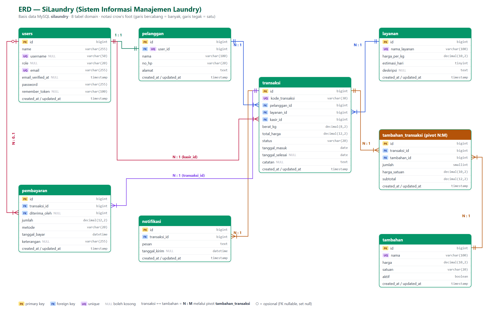

<p align="center"></p>

# SiLaundry — Sistem Informasi Manajemen Laundry

Aplikasi web manajemen laundry berbasis **Laravel 13**, **MySQL**, **Tailwind CSS v4**, **Alpine.js**, dan
ikon **Lucide** dengan fitur **login multi role** (Administrator, Kasir, Pelanggan) dan **manajemen pengguna (CRUD)**.
Desain antarmuka mengikuti standar UI SIMPATFI (sidebar hijau, kartu ringkas, tanpa teks deskripsi).

## Fitur

- Login dengan email & password, redirect otomatis ke dashboard sesuai role.
- Pembatasan akses per role melalui `RoleMiddleware` (halaman 403 jika tidak berhak).
- Pembatasan login: 5 kali gagal → dikunci 60 detik (pesan tampil di form login).
- Manajemen pengguna (khusus Administrator): daftar + pencarian + filter role, tambah, edit,
  hapus (dengan dialog konfirmasi), dan pengaturan role.
- Akun ber-role Pelanggan otomatis memiliki data pelanggan (No HP & alamat).
- Pengaman: admin tidak bisa menghapus / mengubah peran akunnya sendiri; kasir maupun pelanggan
  yang sudah memiliki transaksi tidak bisa dihapus agar riwayat transaksi tetap utuh.

## Role & Hak Akses

| Fitur            | Administrator | Kasir | Pelanggan          |
|------------------|:-------------:|:-----:|:------------------:|
| Login            | ✓             | ✓     | ✓                  |
| Dashboard        | ✓             | ✓     | ✓                  |
| Melihat data     | ✓             | ✓     | ✓ (milik sendiri)  |
| Tambah/Edit/Hapus| ✓             | ✗     | ✗                  |
| Management User  | ✓             | ✗     | ✗                  |

## Instalasi

Membutuhkan PHP 8.3+ (disarankan 8.4), Composer, Node.js 20+, dan MySQL/MariaDB.

```bash
composer install
cp .env.example .env
php artisan key:generate
npm install
npm run build
```

> Hasil build (`public/build`) sudah ikut disimpan di repository, jadi `npm` hanya wajib bila tampilan diubah.

Atur koneksi database pada `.env`:

```env
DB_CONNECTION=mysql
DB_HOST=127.0.0.1
DB_PORT=3306
DB_DATABASE=silaundry
DB_USERNAME=root
DB_PASSWORD=
```

Buat database `silaundry`, lalu jalankan migrasi + seeder dan server:

```bash
php artisan migrate --seed
php artisan serve
```

Buka `http://localhost:8000`.

## Akun Demo (dari seeder)

| Role          | Email                       | Password      |
|---------------|-----------------------------|---------------|
| Administrator | admin@silaundry.test        | password123   |
| Kasir         | kasir@silaundry.test        | password123   |
| Kasir         | siti.kasir@silaundry.test   | password123   |
| Pelanggan     | pelanggan1@silaundry.test   | password123   |
| Pelanggan     | pelanggan2@silaundry.test   | password123   |

## Basis Data (LKP Pertemuan 4)



| Tabel | Model | Peran |
|-------|-------|-------|
| `users` | `User` | Akun & role (admin / kasir / pelanggan) |
| `pelanggan` | `Pelanggan` | Data pelanggan, 1:1 dengan `users` |
| `layanan` | `Layanan` | Master layanan utama + tarif per kg |
| `tambahan` | `Tambahan` | Master layanan tambahan (parfum, hanger, dll.) |
| `transaksi` | `Transaksi` | Transaksi laundry (pelanggan, layanan, kasir) |
| `tambahan_transaksi` | — (pivot) | Relasi N:M transaksi ⟷ tambahan + jumlah/harga |
| `pembayaran` | `Pembayaran` | Riwayat pembayaran (DP / pelunasan), 1:N dari transaksi |
| `notifikasi` | `Notifikasi` | Notifikasi status, 1:N dari transaksi |

- Sumber ERD: `docs/erd/silaundry.dbml` (format dbdiagram.io) dan `docs/erd/erd.html` (render ke PNG).
- Urutan seeder: `UserSeeder` → `LayananSeeder` → `TambahanSeeder` → `PelangganSeeder` → `TransaksiSeeder`.
- `php artisan migrate:fresh --seed` menghasilkan 25 user, 22 pelanggan, 5 layanan, 6 tambahan, 60 transaksi,
  beserta isi pivot, pembayaran, dan notifikasi (jumlahnya acak tetapi selalu konsisten dengan total harga & status).
- Lembar kerja: [`LKP04_2495114006_AhmadMofidurRobbiyalAqla.md`](LKP04_2495114006_AhmadMofidurRobbiyalAqla.md).

## Pengujian

```bash
php artisan test
```

Test fitur berada di `tests/Feature/MultiRoleLoginTest.php`, `tests/Feature/UserManagementTest.php`, dan
`tests/Feature/DatabaseRelasiTest.php` (relasi, constraint, factory & seeder). Menggunakan SQLite in-memory,
butuh ekstensi `pdo_sqlite`.

## Struktur File Utama

| File | Fungsi |
|------|--------|
| `app/Models/User.php` | Model pengguna, konstanta & helper role |
| `app/Http/Controllers/AuthController.php` | Login, redirect sesuai role, logout |
| `app/Http/Controllers/UserController.php` | CRUD pengguna |
| `app/Http/Controllers/DashboardController.php` | Dashboard tiap role |
| `app/Http/Middleware/RoleMiddleware.php` | Pembatasan akses berdasarkan role |
| `app/Http/Requests/*UserRequest.php` | Validasi form pengguna |
| `routes/web.php` | Routing & grup middleware |
| `database/migrations`, `database/seeders` | Struktur database & data dummy |
| `resources/views` | Tampilan: layouts (app, guest), partials (sidebar, flash), components (`x-ui.*`, `x-form.*`), auth, dashboard, users, errors |
| `resources/css/app.css`, `resources/js/app.js` | Tema Tailwind (palet brand hijau), Alpine.js, ikon Lucide |
| `public/img/logo.png` | Logo SiLaundry (PNG transparan) |
| `database/factories` | Factory data dummy (Faker locale `id_ID`) |
| `docs/erd/` | Sumber ERD (DBML + HTML) |
| `screenshots/` | Bukti tangkapan layar: ERD & verifikasi DBMS (LKP 4), pengujian login multi role (LKP 5) |
